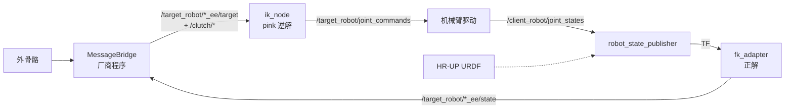

# 4：FK 和 IK 的配置部署（HR-UP 适配 · 新人跟做版）

> - 文档对象：`src/robot_fk_adapter`（FK 正解）、`src/robot_ik_retargeting`（pink IK 逆解），
>   以及它们的 launch / 参数配置。
> - 机器人模型基准（donghai 2026-11-05 指定）：
>   **`src/hr_up_7dof_fixed/urdf/HR-UP-7DOF-3KG-R-B01382-URDF-1029.urdf`，以此为准，不再引用其他机器人模型。**
> - 适用平台：Ubuntu 22.04 + ROS 2 Humble + Python 3.10 + x86_64（与 `deps/` 离线包绑定）。
> - 证据等级：本文所有"预期输出"均为 2026-11-05 开发机离线仿真实测（证据等级 3，见 `agent/HANDOVER.md`），
>   **不等于真机验收**。真机运动验收必须按 `agent/deployment.md` 门禁另行走 Issue。

---

## 0. 新人先读：这一环在整条链路里的位置

整条遥操作链路（当前仓库设计意图）：



- **FK（正解）**：机械臂关节角 → 末端位姿。给外骨骼反馈"机械臂现在在哪"。
- **IK（逆解）**：外骨骼给出的目标末端位姿 → 关节命令。让机械臂跟着外骨骼动。
- 本文档负责这两个 ROS 包的配置与验证。MessageBridge/Puppetry 配置见
  《2：messgabrige和puppertry的配置》，离线依赖安装见
  《4：FK依赖配置 (1)》（FK）与《3：IK的依赖得配置》（IK），话题改名等现场杂项见《5：部署注意事情》。

---

## 1. 机器人模型基准（URDF 契约）

唯一基准：`src/hr_up_7dof_fixed/urdf/HR-UP-7DOF-3KG-R-B01382-URDF-1029.urdf`
（SolidWorks 导出，ROS 包名 `hr_up_7dof_fixed`）。实测结构（`check_urdf` + XML 解析核对）：

| 项 | 值 |
| --- | --- |
| robot 名 | `HR-UP-7DOF-3KG-R-B01382-URDF-1029` |
| link 数 | 16 |
| 根连杆 | `base_mount` →（fixed 关节 `base_mount_to_base`）→ `base` |
| 双臂挂载 | `Joint1`/`Joint1L` 的父连杆都是 **`base`** |
| 右臂链 | `base → Link1..Link7`，关节 `Joint1..Joint7`（7 个 revolute），末端 **`Link7`** |
| 左臂链 | `base → Link1L..Link7L`，关节 `Joint1L..Joint7L`（7 个 revolute），末端 **`Link7L`** |
| 关节限位 | 全部 ±2.967 rad（±170°），URDF `<limit>` 内声明 |
| URDF 里有没有 `base_link`？ | **没有**。也没有 `left_wrist_roll_link` 等名字——别照抄其他机器人的 frame 名 |

左右臂命名依据：SolidWorks 导出 CSV（同目录 `HR-UP-7DOF-3KG-R-B01382-URDF-1029.csv`）
里，不带 L 的链组件名是 `R1..R7`（Right），带 L 的是 `L1..L7`（Left）。
**"哪个 link 对应操作者的物理左手/右手"仍属真机核对项**（见第 10 节销号表）——URDF 是几何，
物理左右要上机确认。

一个容易踩的几何坑：`base_mount → base` 之间有一个固定旋转（rpy = -90°, -90°, 0），
所以**在 `base` 系里双臂挂载点沿 z 轴分开（z = ±0.194）**，不是直觉上的 y 轴左右分开。
零位（全关节 0）时实测末端位姿：

| 末端 | position (x, y, z) | orientation (x,y,z,w) |
| --- | --- | --- |
| `Link7L`（左） | (-0.6764, 0, **+0.3440**) | (0.5, 0.5, 0.5, 0.5) |
| `Link7`（右） | (-0.6764, 0, **-0.3440**) | (-0.5, -0.5, +0.5, +0.5) |

这套零位数值可以作为部署后的第一个"眼见为实"对照点。

**URDF 语法检查**（开发机有 `check_urdf`；离线包不含 `liburdfdom-tools`，离线真机跳过此步，
打包前在开发机做完即可）：

```bash
check_urdf src/hr_up_7dof_fixed/urdf/HR-UP-7DOF-3KG-R-B01382-URDF-1029.urdf
# 实测输出：
# robot name is: HR-UP-7DOF-3KG-R-B01382-URDF-1029
# ---------- Successfully Parsed XML ------------
# root Link: base_mount has 1 child(ren)
#     child(1):  base
#         child(1):  Link1 ...
```

常见 URDF 错误（换 URDF 时参考）：

| 错误信息 | 原因 | 解决方案 |
| --- | --- | --- |
| `No root link found` | URDF 没有根链接 | 确保第一个 `<link>` 没有 parent |
| `Link XXX has no parent` | 运动学链断开 | 检查所有 link 是否通过 joint 连接 |
| `Joint XXX child XXX is not unique` | 子链接重复 | 每个 link 只能是一个 joint 的 child |

---

## 2. 帧契约（改任何 frame 参数前必读）

**三处必须一致，改一处必须同步改另外两处：**

```text
MessageBridge.yaml.base_frame  ==  fk_adapter.base_frame  ==  ik_retargeting.ref_link_name
             == "base"（HR-UP 的值；不是 base_link）
```

| 文件 | 参数 | HR-UP 值 | 备注 |
| --- | --- | --- | --- |
| `standalone/bin/ROS_2/config/MessageBridge.yaml` | `frame_ids.base_frame` | `base` | 外骨骼→机械臂方向消息的参考系 |
| `src/hr_exo_teleop/config/hr_up.yaml` | `fk_adapter.base_frame` | `base` | 参数中枢（整链联调用） |
| `src/robot_fk_adapter/launch/robot_fk_adapter.launch.py` | `base_frame` | `base` | FK 单模块调试用 |
| `src/robot_ik_retargeting/launch/hr_up_ik_retargeting.launch.py` | `root_link_name` / `ref_link_name` | `base` / `base` | IK 单模块调试用 |
| `src/hr_exo_teleop/config/hr_up.yaml` | `ik_retargeting.root_link_name` / `ref_link_name` | `base` / `base` | 参数中枢 |

容易混淆的两个点：

1. **`root_link_name` vs `ref_link_name`（IK）**：`root_link_name` 是 IK 模型的根，
   `ref_link_name` 是"目标位姿相对哪个坐标系"。HR-UP 两者都填 `base`。
   若 `ref_link_name` 留空，代码自动回落到 `root_link_name`；若填了一个模型里不存在的 frame，
   启动日志会 WARN 并回落（`Reference Frame 'xxx' NOT FOUND! Fallback to ...`）——
   看到 NOT FOUND 就说明配置错了。
2. **MessageBridge 的 `exo_left/right_ee_frame` 不要动**：那是外骨骼侧的 TF 可视化帧，
   与机械臂的 `Link7`/`Link7L` 是两棵不同的 TF，混用会冲突（详见文档 2）。

IK 目标 link 的**顺序约定**：`target_link_names = ["Link7", "Link7L"]`，
代码里固定解读为 `[0]=右臂末端、[1]=左臂末端`
（`ik_node.py`：`self.ee_frames = {'right': target_links[0], 'left': target_links[1]}`）。
顺序颠倒会导致左右臂互相跟对方的指令。

---

## 3. 配置文件全景（哪个文件管什么）

| 文件 | 角色 | 什么时候用 |
| --- | --- | --- |
| `src/hr_exo_teleop/config/hr_up.yaml` | **参数中枢（单一真相）**：FK/IK/dummy 全部业务参数 | 整链联调（`teleop_sim` / `teleop_real`） |
| `src/hr_exo_teleop/launch/teleop_sim.launch.py` | 整链仿真 launch（含 dummy 假体闭环） | 无外骨骼/真机时验证全链路 |
| `src/hr_exo_teleop/launch/teleop_real.launch.py` | 整链真机 launch（无仿真节点） | 真机联调 |
| `src/robot_fk_adapter/launch/robot_fk_adapter.launch.py` | FK 单模块 launch（自带 dummy/RViz） | 单独调 FK |
| `src/robot_ik_retargeting/launch/hr_up_ik_retargeting.launch.py` | IK 单模块 launch（仅 ik_node） | 单独调 IK |
| `src/robot_ik_retargeting/launch/g1_ik_retargeting.launch.py` | G1 机器人样例（厂商遗留，与 HR-UP 无关） | 仅作写法参考 |

原则：**业务参数改 `hr_up.yaml`；单模块 launch 里的参数只在单独调试时生效**，
两边数值必须保持一致（当前一致）。

---

## 4. 2026-11-05 已完成的配置修改（donghai 指定 URDF 基准后）

### 4.1 `src/robot_fk_adapter/launch/robot_fk_adapter.launch.py`（修改）

| 项 | 修改前（厂商 G1/HU_D04 遗留） | 修改后（HR-UP） |
| --- | --- | --- |
| 描述包 | `HU_D04_description`（仓库里不存在，首启必挂） | `hr_up_7dof_fixed` |
| URDF 路径 | `urdf/HU_D04_01.urdf` | `urdf/HR-UP-7DOF-3KG-R-B01382-URDF-1029.urdf` |
| RViz 配置 | `rviz/urdf.rviz` | `rviz/hr_up_fixed.rviz` |
| `base_frame` | `base_link`（URDF 中不存在） | `base` |
| `left_ee_frame` | `left_wrist_roll_link`（不存在） | `Link7L` |
| `right_ee_frame` | `right_wrist_roll_link`（不存在） | `Link7` |
| `use_sim` 默认值 | `false`（真机默认，不动） | 同左。**离线验证时命令行传 `use_sim:=true`** |

另外发现并修复一个会导致**任何 URDF 都起不来**的坑（见第 7.1 节）：
`robot_description` 参数必须用 `ParameterValue(..., value_type=str)` 包裹。

### 4.2 `src/robot_ik_retargeting/launch/hr_up_ik_retargeting.launch.py`（新增）

厂商只有 G1 的 IK launch（`g1_ik_retargeting.launch.py`，参考用，未改动）。
按部署流程"第三步：配置 IK 解算核心"新增 HR-UP 版，关键参数：

```python
'root_link_name': 'base',   # URDF 根链: base_mount -(fixed)-> base，双臂挂在 base 上
'ref_link_name': 'base',    # 必须与 fk_adapter.base_frame / MessageBridge.yaml.base_frame 一致
'target_link_names': ["Link7", "Link7L"],   # 顺序固定 [右, 左]，不能颠倒
'max_dof': 7,               # 双臂均为 7 DOF
```

拟人化参数 `preferred_joints` / `preferred_angles` 当前**留空**（全零中立位），
原因与填写方法见第 6 节。launch 里空列表不是不传参数，而是只在填了内容后才传入
（Humble launch 无法为空列表定型，见第 7.2 节）。

### 4.3 `src/robot_ik_retargeting/robot_ik_retargeting/ik_node.py`（最小修改）

`preferred_joints` / `preferred_angles` 两个参数的声明加了 `dynamic_typing=True`。
原因：HR-UP 的拟人化角度在真机实测前刻意留空，而原声明
`declare_parameter('preferred_joints', value=None, descriptor=STRING_ARRAY)`
在"参数未被 launch/yaml 提供"时会抛 `ParameterUninitializedException` 让节点直接起不来
（开发机实测确认）。`dynamic_typing=True` 让"没提供"合法回落为空。
不影响已提供参数的任何行为。

### 4.4 `src/hr_exo_teleop/launch/teleop_sim.launch.py`、`teleop_real.launch.py`（最小修改）

与 4.1 相同的 `robot_description` → `ParameterValue` 修复（两个整链 launch 用的是同一种
会被 Humble 拒绝的写法，属同一问题，一并修掉）。

### 4.5 调试日志增强（2026-11-05 第二批，donghai 需求：真机调试留痕）

- `joint_to_pose_adapter.py`：启动配置速查、TF 查询失败告警（原来静默吞掉，
  现节流 5s 并带 frame 对与排查提示）、5s 统计心跳；
- `ik_node.py`：启动配置速查、离合断开边沿日志、单次求解超控制周期告警、5s 统计心跳
  （指令频率/求解耗时均值与最差/循环超时计数）——**只加日志与计数，不改控制流**；
- 3 个 launch 的 fk/ik 节点改 `output='both'`：屏幕可见 + 自动写入
  `~/.ros/log/<当次运行>/launch.log`（实测：`output='screen'` 不落盘，`both` 落盘）；
- 新增 `scripts/collect_logs.sh`：只读打包最近 N 次运行日志 + 系统环境快照（带 SHA256）。
- 日志含义速查见第 9 节；台账登记见 `agent/LEDGER.md` P-014。

---

## 5. 部署与验证步骤（新人照做，全部无运动）

前提：《4：FK依赖配置 (1)》步骤 0–5 已完成（打包/校验/离线装依赖/编译通过，
`Summary: 4 packages finished`）。以下每步都验证过，"预期输出"即实测原文。

### 5.1 启动前自检（IK 需 pinocchio/pink）

IK 节点解释器固定用系统 Python，venv 里的 pink 系包必须 `PYTHONPATH` 注入
（原理与完整配方见《3：IK的依赖得配置》§2.1/§4）。逐字执行：

```bash
bash -c 'source /opt/ros/humble/setup.bash && source ~/hr-exo-robot/install/setup.bash && \
 export PYTHONPATH=~/pink_venv/lib/python3.10/site-packages:${PYTHONPATH:-} && \
 python3 -c "import pinocchio, pink, numpy; print(pinocchio.__version__, pink.__version__, numpy.__version__)"'
# 实测期望: 4.0.0 3.5.0 1.26.4   （numpy 显示 2.x = 被遮蔽，回依赖文档重装）
# 开头的 scipy UserWarning（"A NumPy version >=1.17.3 and <1.25.0 is required"）为良性警告，可忽略
```

FK 链路（`robot_fk_adapter`）不依赖 pinocchio/pink，无此要求。

### 5.2 FK 链路无运动启动验证（use_sim，不接真机）

```bash
# 终端 A（保持 source 与 PYTHONPATH 环境）
ros2 launch robot_fk_adapter robot_fk_adapter.launch.py use_sim:=true use_rviz:=false
```

新终端检查：

```bash
ros2 node list
# 实测: /dummy_driver  /fk_adapter  /robot_state_publisher
ros2 topic hz /client_robot/joint_states --window 100
# 实测: average rate: 499.6（dummy 按 launch 里 publish_frequency=500.0 发布）
ros2 topic echo --once /target_robot/left_ee/state
# 实测: frame_id: base，position ≈ (-0.6764, 0, +0.344)（零位参考值，见第 1 节表格）
ros2 topic echo --once /target_robot/right_ee/state
# 实测: frame_id: base，position ≈ (-0.6764, 0, -0.344)
```

三个节点齐、两个 state 话题有数且 frame_id 是 `base`，FK 链路即通。

### 5.3 FK 输出正确性对照（与 TF 直接查询比对）

```bash
ros2 run tf2_ros tf2_echo base Link7L
# 实测: Translation: [-0.676, 0.000, 0.344]
#       Rotation: in Quaternion (xyzw) [0.500, 0.500, 0.500, 0.500]
# 与 5.2 的 echo 数值一致（允许 1e-3 量级舍入差）
```

> 注意对照的 frame 顺序：`tf2_echo <base_frame> <末端link>`，与 FK 配置同向。

### 5.4 IK 链路无运动启动验证

```bash
# 终端 B（5.2 的 FK launch 保持运行，dummy 提供 /client_robot/joint_states）
ros2 launch robot_ik_retargeting hr_up_ik_retargeting.launch.py
```

启动日志必须看到（实测原文）：

```text
[ik_node] Reference Frame 'base' active.
[ik_node] IK Node坐标系配置：root_link='base', ref_link='base'
```

- 若出现 `Reference Frame 'xxx' NOT FOUND! Fallback to ...`：launch 里填了 URDF 不存在的
  frame，回到第 2 节契约改配置。
- 若出现 frame mismatch 警告（`Frame mismatch for left: expected 'base', got 'xxx'`）：
  FK 的 `base_frame` 与 IK 的 `ref_link_name` 不一致，回到第 2 节同步两处。
- 正常情况下随后会看到
  `✅ IK Node 成功接入有效关节数据，q_commanded 已对齐到真机状态，准许输出控制指令！`
  （这是 IK 的初始化门控：**没收到有效关节数据之前绝不输出指令**，属安全特性，
  详见第 8 节。）

此时 `ros2 topic echo /target_robot/joint_commands` 应**无输出**——因为离合
（`/clutch/*`）未使能，IK 故意保持静止。这不是故障。

### 5.5 IK 闭环仿真验证（发布目标位姿 + 离合，机械臂无实物）

用一个小发布脚本模拟"外骨骼 + Puppetry"的角色（仅本机/离线环境使用，真机严禁手动发）：

```python
# /tmp/exo_test_pub.py —— 持续发布左臂目标位姿(base 系, 零位沿 z+2cm)与离合使能
import rclpy, time, sys
from rclpy.node import Node
from geometry_msgs.msg import PoseStamped
from std_msgs.msg import Bool

rclpy.init()
n = Node('exo_test_pub')
pc = n.create_publisher(PoseStamped, '/target_robot/left_ee/target', 10)
cl = n.create_publisher(Bool, '/clutch/left', 10)
b = Bool(); b.data = (sys.argv[1] == 'on')
t0 = time.time()
while time.time() - t0 < float(sys.argv[2] if len(sys.argv) > 2 else 8):
    if b.data:  # 目标: 零位 (-0.6764, 0, 0.344) 沿 base 系 z 方向 +2cm
        m = PoseStamped()
        m.header.frame_id = 'base'
        m.header.stamp = n.get_clock().now().to_msg()
        m.pose.position.x, m.pose.position.y, m.pose.position.z = -0.6764, 0.0, 0.364
        m.pose.orientation.x = m.pose.orientation.y = 0.5
        m.pose.orientation.z = m.pose.orientation.w = 0.5
        pc.publish(m)
    cl.publish(b)
    rclpy.spin_once(n, timeout_sec=0.01)
    time.sleep(0.02)
```

```bash
python3 /tmp/exo_test_pub.py on 10     # 使能 10 秒
python3 /tmp/exo_test_pub.py off 2     # 断开离合
```

**实测结果（判定标准）**：

- ik_node 日志：`[LEFT] 使能接管，位置无跳变，速度历史已重置`，随后诊断日志
  `位置差：20.00mm | 旋转差：0.00°`（正好是脚本给的 2cm 偏移）；
- `/target_robot/joint_commands` 开始有输出（无频率输出可先 `ros2 topic list` 确认话题在）；
- `/target_robot/left_ee/state` 的 z 从 0.344 连续变化到 ≈0.364（实测 0.36399，毫米级收敛）；
- 断开离合后指令停止更新，位姿保持。

到这一步，FK+IK 离线部署与闭环仿真验证全部完成。可以进入整链仿真
（`ros2 launch hr_exo_teleop teleop_sim.launch.py`，参数来自 `hr_up.yaml`，已实测可启动），
或按 `agent/deployment.md` 申请真机分阶段验收。

---

## 6. 拟人化姿态调优（preferred_joints / preferred_angles）

**原理**：pink 的 `PostureTask` 在零空间（null-space）里施加微弱力，把关节拉向
`preferred_angles` 给出的期望姿态，用于在同等末端位姿下挑选更"自然"的解
（比如肘部朝外而不是别死）。

**当前留空的原因**：HR-UP URDF 由 SolidWorks 导出，关节轴向/正方向的工程定义
（哪边弯是正）还没在实机上核对过。瞎填符号会引导出别扭甚至错误的姿态分支，
所以先全零中立位（留空），真机实测后填。

**填写方法（真机核对后）**：

1. 确定要干预的关节（一般是肩、肘），HR-UP 关节名为 `Joint1..Joint7`（右）/
   `Joint1L..Joint7L`（左），大小写敏感；
2. 用 RViz（`use_rviz:=true`）或示教确认期望角度（**弧度制**），注意正负号要按实机
   电机方向核对——肘部向后折就把符号反过来；
3. 两张表按顺序一一对应：

```yaml
# hr_up.yaml 里（参数中枢，整链用这个）：
ik_retargeting:
  ros__parameters:
    preferred_joints: ["Joint4", "Joint4L"]
    preferred_angles: [0.5, -0.5]
```

```python
# hr_up_ik_retargeting.launch.py 里（单模块调试用），填入后 launch 会自动传入：
preferred_joints_default = ["Joint4", "Joint4L"]
preferred_angles_default = [0.5, -0.5]
```

**坑**：这两个参数要么都填、要么都留空——launch 侧只在 `preferred_joints` 非空时才把
两个参数一起传给节点（Humble launch 无法为空 Python 列表定型，见第 7.2 节）；
yaml 侧（`hr_up.yaml`）空列表 `[]` 已实测可用，可放心写。

---

## 7. 已知问题与坑（开发机实证发现，均已修复或绕开）

### 7.1 `robot_description` 不包 `ParameterValue` 则任何 URDF 都起不来

- **症状**：launch 报 `Unable to parse the value of parameter robot_description as yaml`
- **原因**：Humble 的 launch_ros 会把参数值当 YAML 解析来推断类型，URDF 是 XML，必炸。
- **修法**（本仓库 3 个 launch 已全部修复）：

```python
from launch_ros.parameter_descriptions import ParameterValue
parameters=[{'robot_description': ParameterValue(Command(['cat ', urdf_path]), value_type=str)}]
```

### 7.2 空 Python 列表参数在 Humble launch 中无法定型

- **症状**：launch 报 `Expected 'value' to be one of [<class 'float'>, ...], but got '()'`
  （parameters 字典里传 `[]`），或 `Got a list of '<class 'str'>', expected a list of
  '<class 'float'>'`（试图用 `ParameterValue(..., value_type=List[float])` 包空列表）。
- **原因**：Humble launch 靠元素类型推断数组参数类型，空列表推不出来；
  `ParameterValue` 的 `value_type` 也只认 Python 类型（`str`/`float`/`List[str]`…），
  不认 `rcl_interfaces` 的枚举，也不接受空列表+`List[float]` 组合。
- **修法**：独立 launch 只在列表非空时才传参（本仓库已实现）；节点侧
  `ik_node.py` 声明参数加 `dynamic_typing=True` 兜底"参数未提供"的情形。
  **yaml 参数文件里的空列表 `[]` 不受影响，实测可用**（rclpy 的 yaml 加载路径不同）。

### 7.3 其他

- **numpy 2.x 会段错误**：`import pinocchio` 直接崩，属依赖红线不是本环节问题，
  处理见《3：IK的依赖得配置》§2.2 与《4：FK依赖配置 (1)》§8 Q6。
- **scipy UserWarning**（`A NumPy version >=1.17.3 and <1.25.0 is required...`）：
  apt 版 scipy 对 numpy 1.26.4 的版本区间提示，良性，忽略。
- **`check_urdf` 不在离线依赖**：离线真机跳过 URDF 语法检查，打包前在开发机做（第 1 节）。
- **Ctrl-C 停 launch 时的 `process has died ... exit code -2` / KeyboardInterrupt 回溯**：
  SIGINT 正常关停噪音，不是故障，以节点生命周期日志为准。

---

## 8. 接真机前检查单（逐项打勾，缺一不接）

**通用（FK/IK 都要）**：

1. `use_sim:=false`（真机整链用 `teleop_real.launch.py`，本身不含 dummy）；
   FK 单模块调试 launch 默认 `use_sim:=false`，确认没有在命令行误传 `:=true`。
2. 帧契约三处一致（第 2 节表格逐行核对）。
3. 话题对齐：真机驱动发的关节状态必须重映射成 `/client_robot/joint_states`
   （方法见《5：部署注意事情》第 6 条）；IK 输出 `/target_robot/joint_commands`
   要由机械臂侧接住（name/position/velocity 三字段都有）。
4. JointState 输入规范（FK 与 IK 都吃 `/client_robot/joint_states`）：
   - `name` 含 URDF 全部 14 个非固定关节，**大小写敏感**：`Joint1..Joint7`、`Joint1L..Joint7L`；
   - `position` 弧度制，长度与 `name` 一致；
   - `header.stamp` 填当前 ROS 时间，时间戳为 0 或严重滞后 → TF 变换超时/滤波器异常。
5. 双机部署先对时（chrony/ntp），否则 TF 查询超时。

**IK 特有**：

6. 初始化门控：IK 在收到**有效**关节数据前拒绝一切输出（日志持续
   `⏳ 正在等待有效且完整的 /client_robot/joint_states 数据...`）。
   上真机看到这条日志常驻，先查第 4 条，而不是去动机械臂。
7. 离合行为：使能瞬间 IK 把 `q_commanded` 同步到当前实测关节角（位置同步 +
   速度历史清零 + 软启动 0.5s + 前 3 周期限速 30%），这是防跳变设计；
   全关时指令绝对静止。
8. `/clutch/left`、`/clutch/right` 是 `std_msgs/Bool`，由 MessageBridge 按
   外骨骼离合事件发布（见文档 2），不要手动常置 true。

**红线**（`agent/AGENTS.md` / `agent/deployment.md`）：
未确认命令话题、关节名称/顺序/符号、限位、控制频率、会话门控和急停机制前，
**不允许下发真机运动命令**。编译/仿真通过 ≠ 真机验收。

---

## 9. 日志记录与现场取证（真机调试）

### 9.1 日志在哪

- **屏幕**：所有关键日志实时可见；
- **落盘**：fk/ik 节点 `output='both'`，节点输出自动写入
  `~/.ros/log/<运行时间戳>/launch.log`（实测 Humble：`output='screen'` 不落盘，`both` 落盘；
  每次启动一个新目录）；
- **打包回传**：调试结束后 `bash scripts/collect_logs.sh [最近N次] [输出目录]`，
  产物 `/tmp/hr-exo-logs-<时间戳>.tar.gz`（运行日志 + 系统环境快照 + SHA256 清单）。
  回传后校验：`cd <产物目录> && sha256sum -c <文件名>.sha256`。
- 想要更细的日志级别：`ros2 launch ... --log-level fk_adapter:=debug`（节点名:=级别）。
- 涉及运动问题请同时录包：`ros2 bag record /client_robot/joint_states /target_robot/left_ee/state /target_robot/right_ee/state /target_robot/left_ee/target /target_robot/right_ee/target /target_robot/joint_commands /clutch/left /clutch/right`
  （录包属真机操作，按门禁走 Issue）。

### 9.2 日志速查表（看到什么 → 说明什么 → 做什么）

| 日志（节点） | 含义 | 现场动作 |
| --- | --- | --- |
| `FK adapter 配置: base_frame='base', left_ee_frame='Link7L'...`（fk_adapter） | 配置生效回显 | 与 §2 契约表核对 |
| `IK 配置速查: ... root_link='base', ref_link='base', right_ee='Link7', left_ee='Link7L'...`（ik_node） | 配置生效回显 | 同上；preferred 共 0 个=未填拟人化 |
| `Reference Frame 'base' active.`（ik_node） | 参考系在 URDF 模型中存在 | 无 |
| `Reference Frame 'xxx' NOT FOUND! Fallback to ...`（ik_node） | ref_link_name 填了不存在的 frame | 改 §2 契约，重启 |
| `Frame mismatch for left: expected 'base', got 'xxx'`（ik_node） | FK 的 base_frame 与 IK 的 ref_link_name 不一致 | 三处契约同步（§2） |
| `⏳ 正在等待有效且完整的 /client_robot/joint_states 数据...`（ik_node，常驻） | 没收到含有效关节数据的 JointState | 查上游话题名/关节名大小写（`Joint1..7`/`Joint1L..7L`）/时间戳；**此时 IK 拒绝输出，属安全门控** |
| `✅ IK Node 成功接入有效关节数据...`（ik_node） | 初始化门控通过，允许输出 | 无 |
| `TF 查询失败(共N次): base -> Link7L ...`（fk_adapter，节流5s） | TF 树缺这段链/时间戳异常 | 查 robot_state_publisher 是否在跑、URDF 是否含这两个 link、双机对时 |
| `统计[5s]: joint_states 帧数=..., 实测频率≈...Hz, 发布... TF查询失败...`（fk_adapter） | 链路健康心跳 | 频率应≈上游发布频率；失败数启动头 1s 内有零星属正常（TF 树就绪前的瞬态），持续>0 才是故障 |
| `统计[5s]: 指令发布≈...Hz, 求解N次 平均...ms 最差...ms, 循环超时N次`（ik_node） | IK 健康心跳 | 未使能时求解 0 次、指令 0 属正常；最差求解耗时接近周期 4.0ms 即预警 |
| `IK 单次求解 XXms 超过控制周期`（ik_node，节流5s） | 求解超周期→掉帧/追赶（Walker S2 真机教训） | 降频/查 CPU 争用/绑核 |
| `Loop skipped, dt=...ms (system lag)`（ik_node） | 循环被系统挂起 | 同上；持续出现记录次数（心跳里的"循环超时"） |
| `[LEFT] 使能接管，位置同步跳变.../位置无跳变...`（ik_node） | 离合 ON 边沿，位置同步+速度清零 | 与现场操作时刻对照 |
| `[LEFT] 离合断开，指令保持不变`（ik_node） | 离合 OFF 边沿 | 与现场操作时刻对照 |
| `T_target 为 None，未收到目标位姿`（ik_node） | 使能了但没收到 `*_ee/target` | 查 MessageBridge/Puppetry 侧（文档 2） |

### 9.3 现场取证三步（出问题时的标准动作）

1. **别停节点**：先 `ros2 topic hz` 抽查关键话题是否断流（对照 §5.2/§5.5 的基线）；
2. 停止后 `bash scripts/collect_logs.sh 1` 打包当次运行日志与环境快照；
3. 把 tar.gz + .sha256 回传，离线分析按 §9.2 速查表与 `agent/LEDGER.md` 对照，
   新问题按台账格式落账。

---

## 10. 销号表（真机验证后才能销的遗留项）

| # | 事项 | 状态 | 依据/备注 |
| --- | --- | --- | --- |
| 1 | FK/IK/MessageBridge 三处 frame 统一为 `base` | 已按 URDF 定值（donghai 2026-11-05 指定模型基准），真机 TF 树核对后销号 | `check_urdf` 树 + 仿真验证 |
| 2 | `Link7`=右 / `Link7L`=左 的物理左右对应 | 待真机核对 | SolidWorks CSV 组件名 R1-R7/L1-L7 支持该约定 |
| 3 | `preferred_joints/angles` 拟人化角度 | 待真机实测轴向/符号后填（第 6 节） | 当前留空=全零中立位 |
| 4 | 左臂 URDF 镜像正确性与实机零位 | 待真机核对 | 遗留自文档 2 环节 |
| 5 | Puppetry 的 `robot.urdf` 厂商占位假人替换为 HR-UP URDF | 待 donghai 决定是否执行 | 遗留自文档 2 环节 |
| 6 | Puppetry 闭源插件对 14 关节双臂 URDF 的支持 | 待真机验证 | 遗留自文档 2 环节 |
| 7 | 真机运动验收（无运动→单臂低速→双臂→中断恢复） | 另行走 Issue，按 `agent/deployment.md` 门禁 | 本文档只覆盖到离线仿真 |

---

## 11. 维护

- 问题台账（问题/根因/处置追溯）：`agent/LEDGER.md`
- 离线依赖与打包：`deps/README.md`、《4：FK依赖配置 (1)》
- IK 依赖配方（venv/PYTHONPATH/pinocchio 红线）：《3：IK的依赖得配置》
- MessageBridge/Puppetry 与外骨骼侧帧：《2：messgabrige和puppertry的配置》
- 现场注意事项（网段、话题改名、频率）：《5：部署注意事情》
- 部署门禁与产物：`agent/deployment.md`；坐标词汇：`agent/GLOSSARY.md`
- 文档版本：2026-11-05 重写（donghai 指定 URDF 基准，AI 整理并完成开发机仿真验证）；
  同日追加调试日志增强（§4.5/§9）。后续改动随 Issue 回填。
