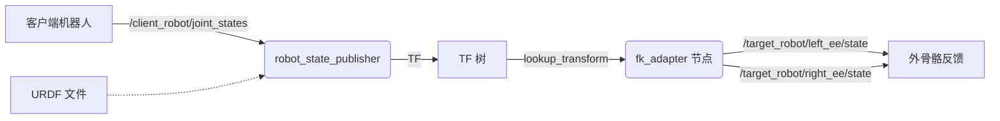

# 4：FK 依赖配置与离线部署（新人跟做版）

> - 文档对象：`src/robot_fk_adapter`（Robot FK Adapter，版本 0.0.1，ament_python）
> - 适用平台：Ubuntu 22.04 + ROS 2 Humble + Python 3.10 + x86_64（与 `deps/` 离线包平台绑定）
> - 2026-11-05 由 donghai 要求重新梳理：核对离线依赖是否齐全，并把步骤写到新人可照做。
> - 验证等级说明：本文中的依赖核对结论属于**离线静态证据**（证据等级 2，见 `agent/HANDOVER.md`），
>   不等于目标机运行证据。真机验收按 `agent/deployment.md` 门禁另行走 Issue。

---

## 1. FK Adapter 是干什么的

FK Adapter 是遥操作链路中"关节角 → 末端位姿"的正解节点：加载机器人 URDF，
订阅关节状态话题，通过 ROS 2 TF 树做运动学正解（Forward Kinematics），
把左右臂末端位姿以 `PoseStamped` 发给外骨骼反馈链路。

数据流（本仓库设计意图，尚未经真机验证）：



---

## 2. 离线依赖核对结论（2026-11-05）

**结论：FK 运行所需的全部依赖均已有离线版本**，位于仓库 `deps/apt/`（25 个 .deb）
与 `deps/pip/`（14 个 wheel），已随 git 提交（commit `56024b4`）。
逐项对照如下（来源：`src/robot_fk_adapter/package.xml` 声明 + launch 链路实测）：

### 2.1 package.xml 声明的运行依赖

| 依赖 | 对应离线包（deps/apt/） | 状态 |
| --- | --- | --- |
| rclpy | ros-humble-rclpy_3.3.22-1jammy | ✅ |
| geometry_msgs | ros-humble-geometry-msgs_4.9.2-1jammy | ✅ |
| sensor_msgs | ros-humble-sensor-msgs_4.9.2-1jammy | ✅ |
| tf2_ros | ros-humble-tf2-ros_0.25.24-1jammy | ✅ |
| robot_state_publisher | ros-humble-robot-state-publisher_3.0.3-2jammy | ✅ |
| urdf | ros-humble-urdf_2.6.1-1jammy | ✅ |

### 2.2 launch 链路额外需要（不在 package.xml 里，但会用到）

| 用途 | 对应离线包 | 状态 |
| --- | --- | --- |
| ros2 launch 框架 | ros-humble-launch / ros-humble-launch-ros | ✅ |
| RViz 监视（`use_rviz:=true` 时） | ros-humble-rviz2_11.2.29-1jammy | ✅ |
| 仿真模式假关节源 | ros-humble-joint-state-publisher_2.4.0-1jammy | ✅ |
| 消息基座 | ros-humble-std-msgs | ✅ |
| 编译/工具 | colcon、rosdep、setuptools、wheel、pytest、venv 等 | ✅ |
| （IK 用，FK 不用） | ros-humble-pinocchio / coal / eigenpy 组 | ✅ |

### 2.3 两个必须知道的前提

1. **目标机必须已装 `ros-humble-desktop` 基线**。`deps/apt/` 只覆盖本项目声明的 ROS 包，
   不含深层系统库（libboost1.74、libeigen3、python3-dev 等），这些假定由桌面基线提供。
   缺件时离线安装会明确报缺哪个 deb（见第 8 节 Q4）。
2. **`deps/pip/` 的 wheel 全是给 IK（Pink/pinocchio 链路）用的，FK 本身一个都不需要**。
   `install_deps.sh` 一次性全装，属正常现象，不用逐个理解。
   配方要点（实证红线，详见 `deps/README.md` 与 `docs/deployment/3：IK的依赖得配置.md`）：
   - Pinocchio 走 apt 不走 pip（pip 的 `pin` 会遮蔽 ROS 版导致求解崩溃）；
   - `pin-pink==3.5.0` 必须 `--no-deps` 安装（脚本已处理）；
   - numpy 锁 1.26.4（2.x 与 apt pinocchio ABI 不兼容，import 即段错误）。

### 2.4 平台绑定警告

wheel/deb 与 **x86_64 + Ubuntu 22.04 + Python 3.10** 绑定。
换架构（如 ARM）或换 Ubuntu 版本，必须在对应平台重跑 `scripts/download_deps.sh` 重新生成。

---

## 3. 迁移部署总流程

与 `agent/deployment.md` 门禁对齐，**每一步都可独立停止检查**，不允许把上传/安装/编译/启动合并成一步：

```text
[开发机] 步骤1 打包 → 步骤2 生成 SHA256
    ↓ 拷贝（U盘/内网 scp）
[真机] 步骤0 只读盘点 → 步骤3 校验 SHA256 → 步骤4 离线装依赖
       → 步骤5 编译 → 步骤6 无运动启动验证 → 步骤7 FK 输出对照
    ↓ 全部通过后
真机运动验收（另行走 Issue，见 agent/deployment.md 第 7 阶段）
```

---

## 4. 详细操作步骤（新人照做）

### 步骤 0：目标机只读盘点（装任何东西之前）

```bash
uname -m                      # 必须是 x86_64
cat /etc/os-release | grep VERSION_ID   # 必须是 22.04
python3 --version             # 必须是 3.10.x
ls /opt/ros/humble/setup.bash # 必须存在（ROS 2 Humble 已装）
ros2 pkg list | grep -c ros-humble || ros2 pkg list | head -5   # 确认桌面基线在
df -h ~                       # 剩余空间建议 > 5 GB
ps aux | grep -E "ros|MessageBridge|Puppetry"   # 记录当前在跑什么
```

把以上输出存档（对应门禁产物 `VERSIONS.md`）。**任何一条不满足，先停下来报告，不要继续。**

### 步骤 1：开发机打包

```bash
cd ~/hr-exo-robot   # 仓库根目录
tar --exclude='.git' --exclude='build' --exclude='install' --exclude='log' \
    --exclude='__pycache__' --exclude='*.bak' \
    -czf /tmp/hr-exo-robot.tar.gz .
```

（排除项依据 `agent/deployment.md`：不带 .git、构建缓存、日志、密钥。）

### 步骤 2：生成校验值并传输

```bash
# 开发机
sha256sum /tmp/hr-exo-robot.tar.gz | tee /tmp/hr-exo-robot.tar.gz.sha256
scp /tmp/hr-exo-robot.tar.gz /tmp/hr-exo-robot.tar.gz.sha256 <真机用户>@<真机IP>:~/
```

### 步骤 3：真机校验（上传后、解压前）

```bash
# 真机
sha256sum -c ~/hr-exo-robot.tar.gz.sha256   # 必须输出 OK，不一致立即停止
mkdir -p ~/hr-exo-robot && tar -xzf ~/hr-exo-robot.tar.gz -C ~/hr-exo-robot
```

### 步骤 4：离线安装依赖

```bash
cd ~/hr-exo-robot
./scripts/install_deps.sh
```

脚本会依次做三件事，每件都会打印进度：

1. `apt-get install --no-download deps/apt/*.deb`：离线装 ROS deb（已装过的会被保持，无害）；
2. 先 `--no-deps` 装 `pin_pink` wheel（阻止 pip 拉入遮蔽版 pin），再从 `deps/pip/` 离线装
   根目录 `requirements.txt` 的全部依赖（`--no-index`，完全不访问网络）；
3. 导入自检：逐个 import numpy/scipy/pinocchio/pink 等，并断言 numpy 是 1.x。

**看到 `OK  pinocchio ...` 和 `OK  numpy 1.26.4` 即成功。**
脚本带环境自检：架构/Python 版本不匹配会直接退出并说明原因。

> 备注：`rosdep init/update` 需要联网，离线真机上跳过即可，不影响编译运行（deps/README 已确认）。

### 步骤 5：编译

```bash
cd ~/hr-exo-robot
./scripts/install_deps.sh --build   # 也可手动: source /opt/ros/humble/setup.bash && colcon build --symlink-install
```

确认 `Summary: X packages finished` 无失败。之后每个新终端先 `source ~/hr-exo-robot/install/setup.bash`。

### 步骤 6：首次无运动启动验证（不接真机臂、不下发任何命令）

先只起 FK 链路，`use_rviz:=false`（无头服务器省事，接显示器的机器可开 RViz）：

```bash
ros2 launch robot_fk_adapter robot_fk_adapter.launch.py use_sim:=true use_rviz:=false
```

新开终端检查节点与话题：

```bash
ros2 node list          # 应看到 /robot_state_publisher、/fk_adapter、/dummy_driver
ros2 topic list         # 应看到 /client_robot/joint_states
ros2 topic hz /client_robot/joint_states    # 仿真模式约 500 Hz
```

> ✅ 2026-11-05 起 launch 已按 HR-UP 修好（此前引用不存在的 `HU_D04_description` 包），
> 本步骤可直接执行；FK/IK 配置细节与帧契约见《4：FK_和IK_的配置部署》。

### 步骤 7：FK 输出正确性对照

```bash
# 终端 A：按步骤 6 启动
# 终端 B：
ros2 topic echo /target_robot/left_ee/state
# 终端 C：与 TF 直接查询结果对照，两者应一致（允许 1e-4 量级误差）
ros2 run tf2_ros tf2_echo <base_frame> <末端link>
```

摆动 dummy 关节（或真机关节）时 echo 数值应连续变化。到这一步，FK 离线部署即完成，
可以进入 IK 部署（`docs/deployment/3：IK的依赖得配置.md`）或整体联调。

---

## 5. 启动方式与参数（与代码实测一致）

**launch 只接受两个参数**，末端/基准坐标系在 launch 文件里以节点参数写死：

```bash
ros2 launch robot_fk_adapter robot_fk_adapter.launch.py \
    use_sim:=true     # true=同时起 dummy 假关节源；接真机必须改 false（否则与真实驱动冲突）
    use_rviz:=true    # 是否开 RViz
```

节点参数（在 `launch/robot_fk_adapter.launch.py` 中修改，不是命令行参数；
2026-11-05 已按 HR-UP URDF 定值）：

| 参数名 | launch 当前写死值 | 节点代码默认值（仅无 launch 时生效） | 说明 |
| --- | --- | --- | --- |
| `base_frame` | `base` | `waist_pitch_link` | 位姿参考基准坐标系，**必须是 URDF 里真实存在的 link**（HR-UP 双臂挂在 `base` 上） |
| `left_ee_frame` | `Link7L` | `left_wrist_roll_link` | 左臂末端 link |
| `right_ee_frame` | `Link7` | `right_wrist_roll_link` | 右臂末端 link |

固定话题（代码写死，无参数）：

- 订阅：`/client_robot/joint_states`（`sensor_msgs/msg/JointState`）。
  接真机时若机器人原生话题名不同，用 launch `remappings` 或 `ros2 run ... --remap` 改名重定向（见 `docs/deployment/5：部署注意事情.md` 第 6 条）。
- 发布：`/target_robot/left_ee/state`、`/target_robot/right_ee/state`（`geometry_msgs/msg/PoseStamped`）。

输入数据规范：

1. `header.stamp` 必须填当前 ROS 时间，时间戳为 0 或严重滞后会导致 TF 变换超时；
2. `name` 必须含 URDF 中所有非固定关节名，大小写敏感（仓库 URDF 为 `Joint1..Joint7`、`Joint1L..Joint7L`）；
3. `position` 为弧度制，长度与 `name` 一致。

---

## 6. URDF 与坐标系契约（部署前必读）

本仓库自带的 HR-UP 描述包是 `src/hr_up_7dof_fixed`（ROS 包名即 `hr_up_7dof_fixed`），
URDF 为 `urdf/HR-UP-7DOF-3KG-R-B01382-URDF-1029.urdf`，实测结构：

- **16 个 link**：`base_mount`（根）→ `base` → `Link1..Link7`（一臂）与 `Link1L..Link7L`（另一臂）；
- **14 个 revolute 关节**：`Joint1..Joint7`、`Joint1L..Joint7L`，外加 1 个 fixed（`base_mount_to_base`）；
- URDF 含 31 处 `package://` 网格引用，FK/state_publisher 运行**不需要**网格文件，
  缺包报错可忽略，或制作移除 `<visual>/<collision>` 的精简版 URDF。

**契约定值（donghai 2026-11-05 指定以 `hr_up_7dof_fixed` URDF 为准后）**：

1. `base_frame` = `base`（双臂直接挂在 `base` 上；`base_mount` 是根连杆，臂链参考系不用它）；
2. 左右臂末端 = `Link7L`（左）/ `Link7`（右），依据 SolidWorks 导出 CSV 组件名 R1-R7/L1-L7 约定，
   **物理左右对应仍待真机核对**。
   三处一致约束（MessageBridge.yaml == fk_adapter == ik_retargeting）详见
   《4：FK_和IK_的配置部署》第 2 节；遗留销号项见该文档第 9 节。

---

## 7. 已知偏差（2026-11-05 更新）

1. ~~launch 引用不存在的包~~ **已修复**：`robot_fk_adapter.launch.py` 已改用
   `hr_up_7dof_fixed` + HR-UP URDF，并完成仿真验证（见《4：FK_和IK_的配置部署》§5）。
2. ~~base/末端 link 名与仓库 URDF 不匹配~~ **已修复**：`base` / `Link7L` / `Link7`。
3. `check_urdf` 语法检查工具（`liburdfdom-tools`）**不在**离线依赖里；离线真机可跳过该检查，
   或在开发机上先做完检查再打包。
4. **Humble launch 两个参数坑**（修复时发现，均已处理）：
   `robot_description` 须用 `ParameterValue(..., value_type=str)` 包裹；空 Python 列表参数
   无法定型。细节见《4：FK_和IK_的配置部署》§7.1/§7.2。

---

## 8. 常见问题排查（Troubleshooting）

**Q1: 启动报 `[robot_state_publisher]: Model parsing error`**
URDF 路径错误或文件损坏。检查 launch 里 `urdf_path` 解析出的绝对路径与文件是否存在。

**Q2: 频繁 `LookupTransform Error` / `ExtrapolationException`**
JointState 时间戳与本地时间不同步。真机双机部署用 `chrony`/`ntp` 对时；
仿真/回放加 `use_sim_time:=True`；检查发送端 `header.stamp` 赋值。
另注意：节点默认参数 `base_frame=waist_pitch_link`，若 launch 未生效或 link 名不在 URDF 中，
lookup 会一直失败——先 `ros2 run tf2_tools view_frames` 核对 TF 树里真实的 link 名。

**Q3: 话题有数据但位姿不变**
URDF 中对应关节被设为 `fixed`。本仓库 HR-UP URDF 的 14 个臂关节均为 `revolute`，无此问题；
若换了 URDF 出现此现象，检查 `<joint type>`。

**Q4（离线特有）: `install_deps.sh` 第 1 步 apt 报缺依赖**
深层系统库不在 `deps/apt/`（假定由 ros-humble-desktop 提供）。错误信息会写缺哪个包，
记录后单独在有网机器 `apt-get download <缺的包>` 补进 `deps/apt/` 再传，或临时补网。

**Q5（离线特有）: pip 报 `Could not find a version`**
说明 pip 想联网了。确认命令走的是 `install_deps.sh`（带 `--no-index --find-links=deps/pip`），
且 `deps/pip/` 已随包拷贝完整（14 个 wheel 一个不少）。

**Q6: 自检 FAIL `numpy-1.x-check` 或 import pinocchio 段错误**
numpy 2.x 与 apt pinocchio ABI 不兼容（实证红线）。用
`python3 -m pip install --no-index --find-links=deps/pip --force-reinstall numpy==1.26.4` 回滚。

---

## 9. 维护

- 部署门禁与产物要求：`agent/deployment.md`
- 离线依赖配方与红线：`deps/README.md`、`docs/deployment/3：IK的依赖得配置.md`
- FK/IK 配置细节、帧契约与销号表：`docs/deployment/4：FK_和IK_的配置部署.md`
- 文档版本：2026-11-05 重新梳理（donghai 要求，AI 整理）；后续改动随 Issue 回填。
